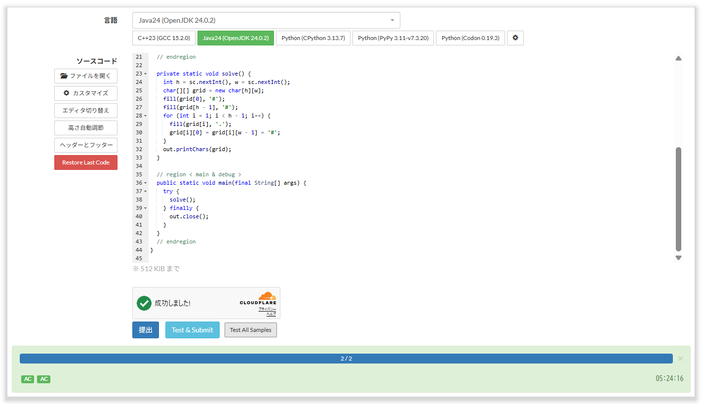
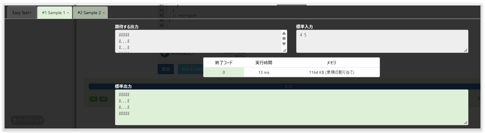

# Easy Test+

[Back to the feature list](../../README.en.md#4-feature-list) ・ [日本語](easy-test.md)

> Run sample tests from the task page and submit when they all pass.

**This feature is off by default. Turn it on in the settings.**

 “Test &amp; Submit” and “Test All Samples” below the submission form. All samples run and the results appear below.

## How it works

Easy Test+ is based on [AtCoder Easy Test v2](https://greasyfork.org/scripts/433152). Enable one or the other to avoid duplicate buttons.

### Running tests and submitting

- Click “Run” beside a sample to test that case, or “Test All Samples” to run them all. Use the bottom panel to enter your own input.
- Starting a test locks the tolerance field and its checkbox. You can change them again once all pending tests have finished.
- “Test & Submit” submits once every sample passes. A change to the tested source, task, language or environment cancels submission and keeps the results. Cancel the pending submission while the tests are running to keep the results without submitting.
- If no samples are found, “Test All Samples” and “Test & Submit” skip testing and submission. You can set a tolerance for comparing output. The tolerance is used only when both tokens are integers or decimals to the end and at least one is a decimal. An exponent such as `1e3` is compared as text. Write the allowed error as a positive number such as `1e-6` or `0.001`. A value that is not a number, such as `10^-6`, marks the field as invalid and stops testing and submission.
- When Local Runner truncates the output at its limit, the result is `OLE` even if the beginning matches.
- When Local Runner transforms the code (for example, adds imports for a Java library) and line numbers in errors are shifted from the editor, the error field starts with the number of shifted lines. This also applies to compile errors.

### Execution environments

- Options depend on the site and language. They include AtCoder custom tests, Python in the browser, PaizaIO and Wandbox. C++ on Wandbox supports AtCoder Library.
- Automatic selection checks the available environments at run time and prefers a compatible Local Runner. A manual choice is saved per language and retries stay on that environment. Automatic retries also exclude PaizaIO and Wandbox as fallback destinations.
- AtCoder custom tests run one at a time. In browsers with Web Locks, tests started in other tabs join the same queue.
- Enable [Local Runner integration](local-runner.en.md) to run supported languages on the configured server. When precompilation is on and the server has a compatible environment, Easy Test+ also sends the code as you edit, even when another environment is selected. The bundled runner reports cumulative allocation for Java and peak memory usage for C, C++ and Python.

### Saved code and shortcuts

- Easy Test+ keeps the last code you ran for each task, up to 10 tasks by default. Choose “Restore Last Code” to restore it for the current task.
- Press <kbd>Ctrl</kbd>+<kbd>Enter</kbd> to test and submit, <kbd>Alt</kbd>+<kbd>Enter</kbd> to test all samples, or <kbd>Ctrl</kbd>+<kbd>Shift</kbd>+<kbd>Alt</kbd>+<kbd>D</kbd> to toggle the bottom panel. You can change the keys in the detailed settings of [Keyboard shortcuts](keyboard-shortcuts.en.md).

 The bottom panel. Switch tabs to see the result of each sample.

## Detailed settings

Open this feature’s “Detailed settings” in CP Toolkit.

| Setting                                  | Default |
|------------------------------------------|---------|
| Precompile edited code with Local Runner | On      |
| Number of tasks to keep code for         | `10`    |
| Allowed error                            | `1e-6`  |

## Pages

- Task pages
- Submit page
- yukicoder problem pages
- Codeforces problem pages
