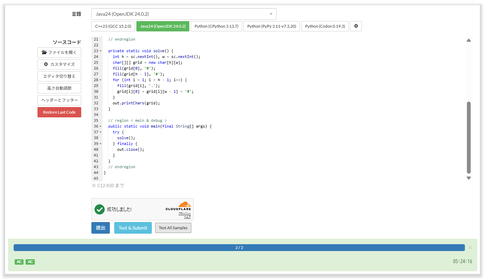
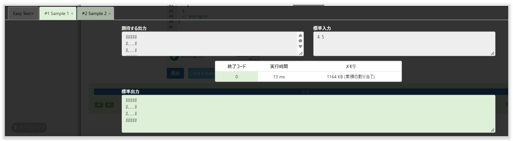

# Easy Test+

[機能一覧へ戻る](../../README.md#4-機能一覧) ・ [English](easy-test.en.md)

> 問題ページでサンプルを実行し、すべて通ったらそのまま提出できます。

**この機能は既定で OFF です。設定画面で有効にしてください。**

 提出欄の下の「Test &amp; Submit」と「Test All Samples」。すべての入出力例を実行し、結果をその下に表示します。

## 使い方

[AtCoder Easy Test v2](https://greasyfork.org/scripts/433152) をもとにした機能です。ボタンが重複するため、どちらか片方を有効にしてください。

### 実行と提出

- 入出力例の「Run」でその例を実行します。「Test All Samples」では全サンプルを実行します。下部のパネルでは入力を自分で指定できます。
- 許容誤差の値とチェックボックスは、実行ボタンを押した時点で固定します。準備中・実行中のテストがすべて終わると、再び変更できます。
- 「Test & Submit」は全サンプルが通ると提出します。テスト開始時のコード・問題・言語・実行先と提出時の内容が違うと、結果を残して提出を取り消します。テスト中に「提出を中止」を押すと、自動提出を取り消せます。
- サンプルが見つからない場合、「Test All Samples」と「Test & Submit」はテストも提出も行いません。出力の比較には許容誤差を指定できます。許容誤差を使うのは、比べる2つが末尾まで整数か小数の表記で、どちらかが小数のときだけです。`1e3` のような指数の表記は、文字列として比べます。許容誤差の欄には `1e-6` や `0.001` のような正の数を書きます。`10^-6` のように数として読めない値は欄を赤くし、実行も提出もしません。
- Local Runner が出力を上限で切り詰めたときは、先頭が合っていても `OLE` にします。
- Local Runner がコードを変換して(Java のライブラリのために import を足すなど)、エラーの行番号がエディタの行とずれるときは、エラーの欄の先頭にずれた行数を表示します。コンパイルエラーでも表示します。

### 実行環境

- サイトと提出言語に応じて、AtCoder のコードテスト、ブラウザ内の Python、PaizaIO、Wandbox などを選べます。Wandbox の C++ では AtCoder Library を使えます。
- 「自動」では実行時に候補を調べ直し、対応する Local Runner が起動していれば優先します。手動で指定した実行先は言語ごとに保存し、再試行も同じ実行先に限定します。自動選択で内部エラーが起きたときも、再試行で PaizaIO や Wandbox へ切り替えることはありません。
- AtCoder のコードテストは順番に実行します。Web Locks が使えるブラウザでは、別のタブで開始したテストも順番を待ちます。
- [Local Runner との連携](local-runner.md) を有効にすると、対応言語を接続先のサーバーで実行できます。事前コンパイルが ON でサーバーに対応する実行環境がある場合は、別の実行先を選択中でも編集中のコードをサーバーに送ります。付属の Runner では Java の累積メモリ割り当て量、C・C++・Python の最大メモリ使用量を表示します。

### コードの保存とショートカット

- 最後に実行したコードを1問につき1件、既定で直近10問分保存します。「Restore Last Code」でその問題のコードを復元できます。
- <kbd>Ctrl</kbd>+<kbd>Enter</kbd> でテスト後に提出し、<kbd>Alt</kbd>+<kbd>Enter</kbd> で全サンプルを実行します。<kbd>Ctrl</kbd>+<kbd>Shift</kbd>+<kbd>Alt</kbd>+<kbd>D</kbd> で画面下部のパネルを開閉します。キーは[ショートカットキー](keyboard-shortcuts.md)の詳細設定で変えられます。

 画面下部のパネル。入出力例ごとの結果をタブで切り替えて確かめられます。

## 詳細設定

設定画面でこの機能の「詳細設定」を開きます。

| 項目                                                | 既定値 |
|-----------------------------------------------------|--------|
| Local Runner で編集中のコードを事前にコンパイルする | ON     |
| コードを保存する問題数                              | `10`   |
| 許容誤差                                            | `1e-6` |

## 動くページ

- 問題ページ
- 提出ページ
- yukicoder の問題ページ
- Codeforces の問題ページ
