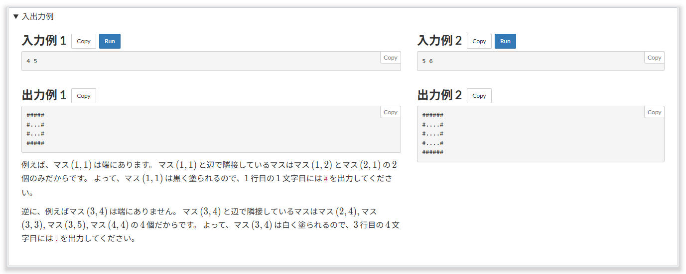

# Side-by-side samples

[Back to the feature list](../../README.en.md#4-feature-list) ・ [日本語](efficient-layout.md)

> Show samples side by side, with each pair's width fitted to its contents automatically.

**This feature is off by default. Turn it on in the settings.**

## How it works

- The input and output formats appear side by side. Each sample input stays with its output, and the pairs sit in a row.
- **By default, each pair adjusts to its longest line.** Pairs share any spare space. Scroll horizontally if the row does not fit.
- For equal widths, select “Fixed” and enter a percentage of the viewport width.

## Detailed settings

Open this feature’s “Detailed settings” in CP Toolkit.

| Setting                                            | Default |
|----------------------------------------------------|---------|
| How to size each sample pair                       | Auto    |
| Fixed width (% of the window width)                | `23`    |
| Maximum width in auto mode (% of the window width) | `40`    |

## Pages

- Task pages
- Printable task list
