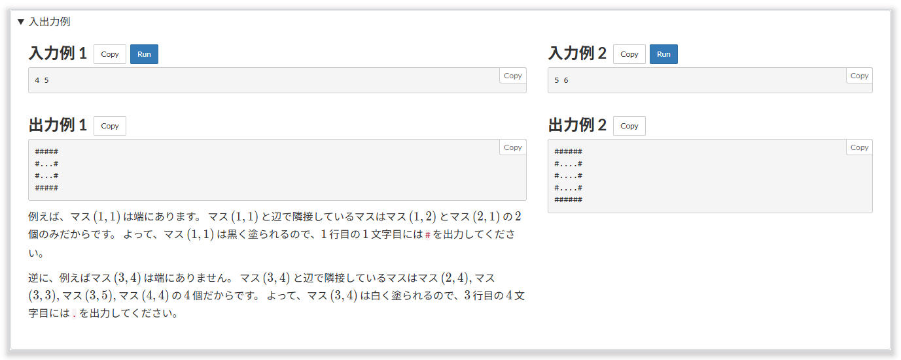

# サンプルの横並び

[機能一覧へ戻る](../../README.md#4-機能一覧) ・ [English](efficient-layout.en.md)

> 入出力例を横に並べ、幅は内容に合わせて自動で決めます。

**この機能は既定で OFF です。設定画面で有効にしてください。**

## 使い方

- 入力形式と出力形式は左右に、入出力例は1組ずつ横に並べます。
- **既定では、各組の幅を入出力例の最も長い行に合わせて自動調整します。** 余白は各組に配分し、全体が収まらないときは横にスクロールできます。
- 各組を同じ幅にするには「固定」を選び、画面幅に対する割合を指定します。

## 詳細設定

設定画面でこの機能の「詳細設定」を開きます。

| 項目                                 | 既定値 |
|--------------------------------------|--------|
| サンプル1組の幅の決め方              | 自動   |
| 固定時の幅（画面幅に対する %）       | `23`   |
| 自動のときの上限（画面幅に対する %） | `40`   |

## 動くページ

- 問題ページ
- 問題の一括表示（印刷用）のページ
