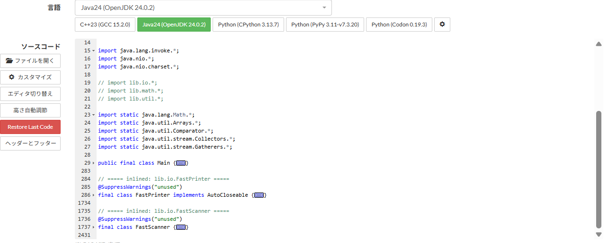
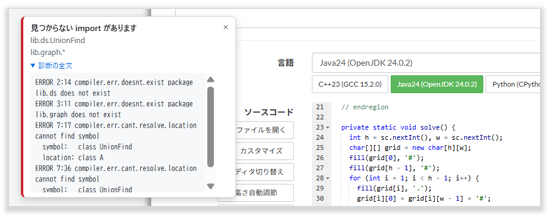

# Submission helper

[Back to the feature list](../../README.en.md#4-feature-list) ・ [日本語](java-submit.md)

> Prepare pasted code for submission.

**This feature is off by default. Turn it on in settings.**

 Java code converted with Local Runner. The class is renamed to <code>Main</code>, the <code>lib</code> imports become comments, and the library classes in use are added at the end and folded.

## How it works

- Pasting a complete solution transforms it into a form that can be submitted. Pasting part of the code into the editor leaves the code unchanged.
- With [Local Runner integration](local-runner.en.md), the code is transformed with the Local Runner language that matches the language selected on the page. Local Runner's settings decide what is done: expanding libraries and renaming the class to `Main` for Java, and running `bundle` and rewriting a debug variable for other languages.
- On AtCoder and yukicoder the helper uses the language selected on the site, and on Codeforces the language selector of the submission form. On AOJ, paiza and Library Checker it does not read the selector and uses the language the editor reports. If the editor cannot tell the language, such as a shared C/C++ mode, the code is not transformed.
- Without Local Runner, only a basic transform for each language is applied. Java is the only such language for now.
- The submission header is added by [Code header and footer](source-comments.en.md).
- Submitting during a transform or header request waits for preparation. An edit, a task or language change, or a failed transform cancels the pending submission. The notification identifies unresolved imports or the first error. Open “Full diagnostics” for details.

 Imports that could not be found are listed in a notification. Open “Full diagnostics” for details.

## Java

- Without Local Runner, the package declaration is removed and the top-level type that has `main` is renamed to `Main`. This only replaces text and is not guaranteed to be correct. Because text alone cannot tell a type from a variable, variables with the same name are renamed too. Comments and strings are left unchanged. If the type with `main` cannot be determined, another `Main` already exists, or a variable with the same name is also used as a member of another value (such as `new A().A`), the original code is kept and a notification tells you so. Use Local Runner for a reliable transform.
- A debug variable is changed only when you set its name in the detailed settings, and only a `boolean name = true` declaration directly in the class that runs is set to `false`. With Local Runner, its `debugFlag` setting decides what is rewritten.
- If you set the library package (e.g. `lib`) in the detailed settings, pasting code that imports it while Local Runner is unreachable shows a notification with a link to the setup steps. Submitting that code as it is causes a compile error.
- Classes and comments are folded when the transformed code is applied to the editor. The keys for folding and for submitting are in [Keyboard shortcuts](keyboard-shortcuts.en.md).

## Detailed settings

Open this feature’s “Detailed settings” in CP Toolkit.

| Setting                                                        | Default |
|----------------------------------------------------------------|---------|
| Java variable to set to false when Local Runner is unavailable | (empty) |
| Package of the Java library that Local Runner expands          | (empty) |
| Fold Java classes and comments after pasting                   | On      |

## Pages

- Task pages
- Submit page
- Custom test page
- yukicoder problem pages
- Codeforces
- AOJ
- Library Checker
- paiza
