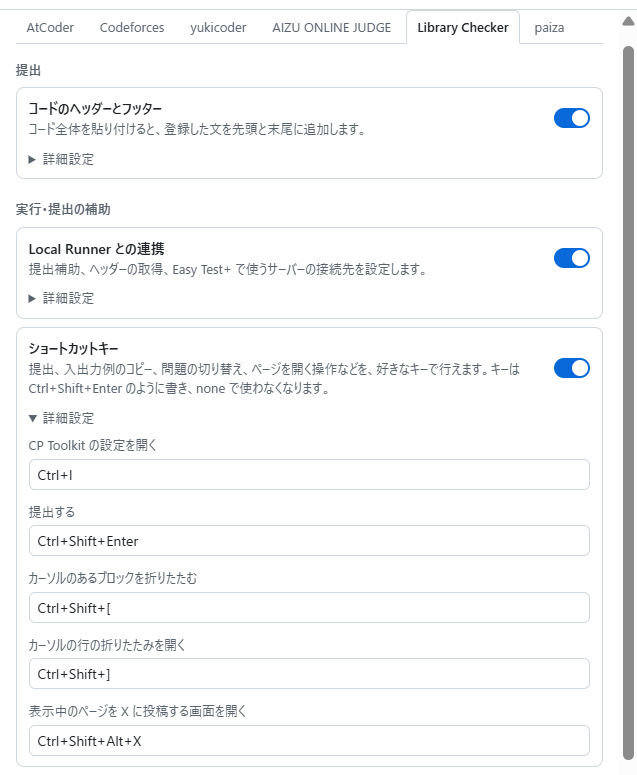

# ショートカットキー

[機能一覧へ戻る](../../README.md#4-機能一覧) ・ [English](keyboard-shortcuts.en.md)

> 提出、入出力例のコピー、問題の切り替え、ページを開く操作などを、好きなキーで行えます。

## 使い方

- 詳細設定で、操作ごとにキーを書きます。`Ctrl`、`Shift`、`Alt`、`Cmd` と、文字や `Enter`、`Escape`、矢印（`Left` など）を `+` でつなぎます（例：`Ctrl+Shift+Enter`、`Alt+S`）。大文字と小文字は区別しません。
- Mac では、`Ctrl` は control キー、`Alt` は option キー、`Cmd` は command キーです。`Option`、`Command` とも書けます。既定のキーは control と option の組み合わせなので、Mac でもそのまま使えます。
- `none` と書くと、その操作にはキーを使いません。
- どのキーも、提出欄やエディタの中にいても反応します。サイトや Easy Test+ のキーと重ならないよう、多くの操作は修飾キーを3つ使います。
- 文字と数字のキーは、Shift などで変わる文字ではなく、押したキーの位置で照合します。`[` と `]` は、Shift を押したときも Shift を押さない記号で書きます（例：`Ctrl+Shift+[`）。
- ボタンのある操作は、ボタンにカーソルを乗せると割り当てたキーを表示します。

### 提出とテスト

- [提出補助](java-submit.md)が貼り付けたコードを変換している間に提出のキーを押すと、変換が終わってから提出します。
- 折りたたみは、カーソルを含むブロック（`{}` やコメントなど）のうち、まだ折りたたんでいない最も内側のものを折りたたみます。開くキーは、カーソルの行にある折りたたみを開きます。言語は問いません。yukicoder のエディタでは動きません。
- テストのキーは、[Easy Test+](easy-test.md) を有効にしたページで動きます。

 提出ボタンにカーソルを乗せると、割り当てたキーを表示します。

### 入出力例と問題文のコピー

- 入力例と出力例は別のキーでコピーします。修飾キーの後ろに入出力例の番号（1〜9）を押します。既定では <kbd>Ctrl</kbd>+<kbd>Alt</kbd>+<kbd>1</kbd> で入力例 1、<kbd>Ctrl</kbd>+<kbd>Shift</kbd>+<kbd>Alt</kbd>+<kbd>1</kbd> で出力例 1 をコピーします。
- AtCoder の提出ページでは、選んでいる問題の入出力例をコピーします。
- 問題文のコピーは、[問題文のコピー](statement-copy.md)の「Copy All」と同じ内容をコピーします。

### 問題の切り替えとページ

- 前後の問題は、問題のページで使えます。問題を開くキーは、修飾キーの後ろに A〜Z を押します。問題の記号は見ず、問題の一覧の上から順に A、B、C… とします。27問目より後は開けません。
- 問題は同じタブで開きます。問題の一覧、自分の提出、順位表、解説、コードテスト、AC の提出は、表示中のページを残すため新しいタブで開きます。
- 解説は、問題のページならその問題の解説を開きます。Codeforces には解説のページがないので、このキーは動きません。
- AC の提出は、[AC 提出へのボタン](submission-shortcuts.md)と同じ一覧を開きます。ボタンを出さない並び順でも使えます。
- X に投稿する画面は、表示中のページの題名と URL を入れて開きます。投稿は開いた画面で自分で行います。

## 詳細設定

設定画面でこの機能の「詳細設定」を開きます。キーはサイトごとに設定でき、そのサイトで動く項目だけを表示します。

 Library Checker のタブで開いた詳細設定。そのサイトで使える5つのキーだけが並びます。

| 項目                                                         | 既定値               | サイト                         |
|--------------------------------------------------------------|----------------------|--------------------------------|
| CP Toolkit の設定を開く                                      | Ctrl+I               | すべて                         |
| 提出する                                                     | Ctrl+Shift+Enter     | すべて                         |
| カーソルのあるブロックを折りたたむ                           | Ctrl+Shift+[         | yukicoder 以外                 |
| カーソルの行の折りたたみを開く                               | Ctrl+Shift+]         | yukicoder 以外                 |
| Easy Test+ でテストしてから提出する                          | Ctrl+Enter           | AtCoder、Codeforces、yukicoder |
| Easy Test+ ですべての入出力例をテストする                    | Alt+Enter            | AtCoder、Codeforces、yukicoder |
| Easy Test+ の画面を開閉する                                  | Ctrl+Shift+Alt+D     | AtCoder、Codeforces、yukicoder |
| 入力例をコピーする（この修飾キーと番号の 1〜9）              | Ctrl+Alt             | AtCoder、Codeforces、yukicoder |
| 出力例をコピーする（この修飾キーと番号の 1〜9）              | Ctrl+Shift+Alt       | AtCoder、Codeforces、yukicoder |
| 問題文をすべてコピーする                                     | Ctrl+Shift+Alt+P     | AtCoder                        |
| 前の問題を開く                                               | Ctrl+Shift+Alt+Left  | AtCoder、Codeforces            |
| 次の問題を開く                                               | Ctrl+Shift+Alt+Right | AtCoder、Codeforces            |
| 問題を開く（この修飾キーと A〜Z。一覧の上から順に A、B、C…） | Ctrl+Alt             | AtCoder、Codeforces            |
| 問題の一覧を開く                                             | Ctrl+Shift+Alt+T     | AtCoder、Codeforces            |
| 自分の提出を開く                                             | Ctrl+Shift+Alt+S     | AtCoder、Codeforces            |
| 順位表を開く                                                 | Ctrl+Shift+Alt+R     | AtCoder、Codeforces            |
| 解説を開く                                                   | Ctrl+Shift+Alt+E     | AtCoder                        |
| コードテストを開く                                           | Ctrl+Shift+Alt+C     | AtCoder、Codeforces            |
| AC の提出を実行時間順に開く                                  | Ctrl+Shift+Alt+F     | AtCoder                        |
| AC の提出をコード長順に開く                                  | Ctrl+Shift+Alt+L     | AtCoder                        |
| AC の提出を提出日時順に開く                                  | Ctrl+Shift+Alt+N     | AtCoder                        |
| AC の提出をメモリ順に開く                                    | Ctrl+Shift+Alt+M     | AtCoder                        |
| 表示中のページを X に投稿する画面を開く                      | Ctrl+Shift+Alt+X     | すべて                         |

同じキーを複数の操作に割り当てると、表の下の操作から試し、そのページで使えなければ上の操作を行います。

## 動くページ

- AtCoder（トップページを含む）
- Codeforces
- AOJ
- Library Checker
- paiza
- yukicoder の問題ページ

入出力例のコピーは AtCoder、Codeforces、yukicoder の問題ページ、問題の切り替えとコンテストのページは AtCoder と Codeforces のコンテストのページで動きます。
