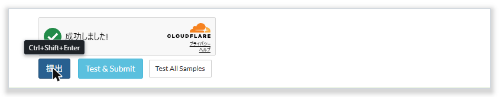

# ショートカットキー

[機能一覧へ戻る](../../README.md#4-機能一覧) ・ [English](keyboard-shortcuts.en.md)

> 提出、入出力例のコピー、問題の切り替え、ページを開く操作などを、好きなキーで行えます。

## 使い方

- 詳細設定で、操作ごとにキーを書きます。`Ctrl`、`Shift`、`Alt` と、文字や `Enter`、`Escape`、矢印（`Left` など）を `+` でつなぎます（例：`Ctrl+Shift+Enter`、`Alt+S`）。大文字と小文字は区別しません。
- `none` と書くと、その操作にはキーを使いません。
- どのキーも、提出欄やエディタの中にいても反応します。サイトや Easy Test+ のキーと重ならないよう、多くの操作は修飾キーを3つ使います。
- 文字と数字のキーは、Shift などで変わる文字ではなく、押したキーの位置で照合します。
- ボタンのある操作は、ボタンにカーソルを乗せると割り当てたキーを表示します。

### 提出とテスト

- 提出のキーを空欄にすると、サイトの既定のキーを使います。AtCoder と Codeforces は <kbd>Ctrl</kbd>+<kbd>Shift</kbd>+<kbd>Enter</kbd>、AOJ と paiza は <kbd>Ctrl</kbd>+<kbd>Enter</kbd>、Library Checker は <kbd>Ctrl</kbd>+<kbd>Shift</kbd>+<kbd>Alt</kbd>+<kbd>Enter</kbd> です。yukicoder には既定のキーはありません。
- [提出補助](java-submit.md)が貼り付けたコードを変換している間に提出のキーを押すと、変換が終わってから提出します。
- 折りたたみは、Java のクラスと複数行コメントを折りたたみます。
- テストのキーは、[Easy Test+](easy-test.md) を有効にしたページで動きます。

### 入出力例と問題文のコピー

- 入力例と出力例は別のキーでコピーします。修飾キーの後ろに入出力例の番号（1〜9）を押します。既定では <kbd>Ctrl</kbd>+<kbd>Alt</kbd>+<kbd>1</kbd> で入力例 1、<kbd>Ctrl</kbd>+<kbd>Shift</kbd>+<kbd>Alt</kbd>+<kbd>1</kbd> で出力例 1 をコピーします。
- AtCoder の提出ページでは、選んでいる問題の入出力例をコピーします。
- 問題文のコピーは、[問題文のコピー](statement-copy.md)の「Copy All」と同じ内容をコピーします。

### 問題の切り替えとページ

- 前後の問題は、問題のページで使えます。問題の記号のキーは、修飾キーの後ろに記号（A〜Z）を押します。Codeforces の C1 のように記号が完全に一致しなければ、その文字で始まる最初の問題を開きます。
- 問題は同じタブで開きます。問題の一覧、自分の提出、順位表、解説、コードテスト、AC の提出は、表示中のページを残すため新しいタブで開きます。
- 解説は、問題のページならその問題の解説を開きます。Codeforces には解説のページがないので、このキーは動きません。
- AC の提出は、[AC 提出へのボタン](submission-shortcuts.md)と同じ一覧を開きます。ボタンを出さない並び順でも使えます。
- X に投稿する画面は、表示中のページの題名と URL を入れて開きます。投稿は開いた画面で自分で行います。

## 詳細設定

設定画面でこの機能の「詳細設定」を開きます。

| 項目                                                 | 既定値           |
|------------------------------------------------------|------------------|
| CP Toolkit の設定を開く                              | Ctrl+I           |
| 提出する（空欄ならサイトの既定）                     | （空欄）         |
| Java のクラスとコメントを折りたたむ                  | Ctrl+Shift+M     |
| Easy Test+ でテストしてから提出する                  | Ctrl+Enter       |
| Easy Test+ ですべての入出力例をテストする            | Alt+Enter        |
| Easy Test+ の画面を開閉する                          | Alt+Escape       |
| 入力例をコピーする（この修飾キーと番号の 1〜9）      | Ctrl+Alt         |
| 出力例をコピーする（この修飾キーと番号の 1〜9）      | Ctrl+Shift+Alt   |
| 問題文をすべてコピーする（AtCoder）                  | Ctrl+Shift+Alt+P |
| 前の問題を開く                                       | Ctrl+Alt+,       |
| 次の問題を開く                                       | Ctrl+Alt+.       |
| 問題を開く（この修飾キーと問題の記号の A〜Z）        | Ctrl+Alt         |
| 問題の一覧を開く                                     | Ctrl+Shift+Alt+T |
| 自分の提出を開く                                     | Ctrl+Shift+Alt+S |
| 順位表を開く                                         | Ctrl+Shift+Alt+R |
| 解説を開く（AtCoder）                                | Ctrl+Shift+Alt+E |
| コードテストを開く                                   | Ctrl+Shift+Alt+C |
| AC の提出を実行時間順に開く（AtCoder）               | Ctrl+Shift+Alt+F |
| AC の提出をコード長順に開く（AtCoder）               | Ctrl+Shift+Alt+L |
| AC の提出を提出日時順に開く（AtCoder）               | Ctrl+Shift+Alt+N |
| AC の提出をメモリ順に開く（AtCoder）                 | Ctrl+Shift+Alt+M |
| 表示中のページを X に投稿する画面を開く              | Ctrl+Shift+Alt+X |

同じキーを複数の操作に割り当てると、表の下の操作から試し、そのページで使えなければ上の操作を行います。例えば paiza では、Easy Test+ が動かないので <kbd>Ctrl</kbd>+<kbd>Enter</kbd> で提出します。

## 動くページ

- AtCoder（トップページを含む）
- Codeforces
- AOJ
- Library Checker
- paiza
- yukicoder の問題ページ

入出力例のコピーは AtCoder、Codeforces、yukicoder の問題ページ、問題の切り替えとコンテストのページは AtCoder と Codeforces のコンテストのページで動きます。
