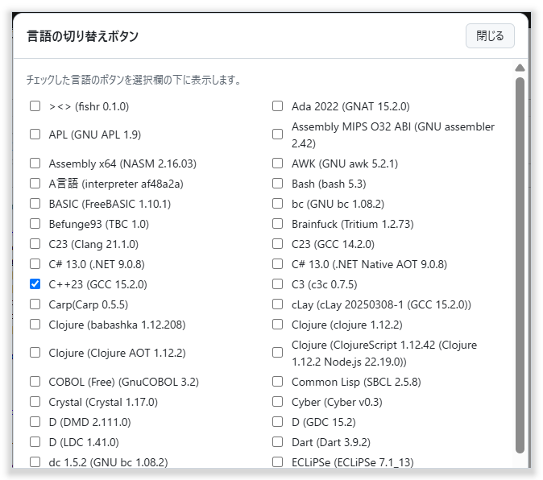

# Language switch buttons

[Back to the feature list](../../README.en.md#4-feature-list) ・ [日本語](language-buttons.md)

> Pin frequently used submission languages and switch between them with one click.

 Language buttons below the language selector.

## How it works

- Click the gear below the language selector and choose the languages to pin.
- The buttons appear on task, submission and custom test pages wherever those languages are available.

 The window opened from the gear button to choose the languages for the buttons.

## Pages

- Task pages
- Submit page
- Custom test page
