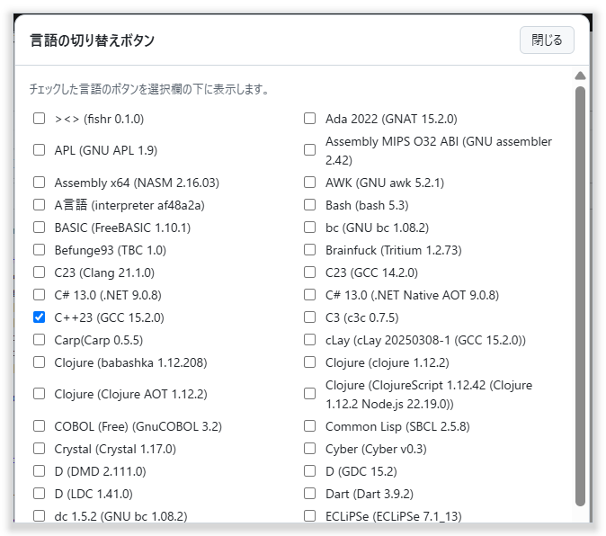

# 言語の切り替えボタン

[機能一覧へ戻る](../../README.md#4-機能一覧) ・ [English](language-buttons.en.md)

> よく使う提出言語を登録し、ボタンひとつで切り替えられます。

 言語の選択欄の下に並ぶ、言語の切り替えボタン。

## 使い方

- 言語欄の下にある歯車を押し、ボタンにしたい提出言語を選びます。
- 登録した言語のボタンは、問題・提出・コードテストの各ページに表示されます。

 歯車のボタンから、ボタンにする言語を選ぶ画面。

## 動くページ

- 問題ページ
- 提出ページ
- コードテストのページ
