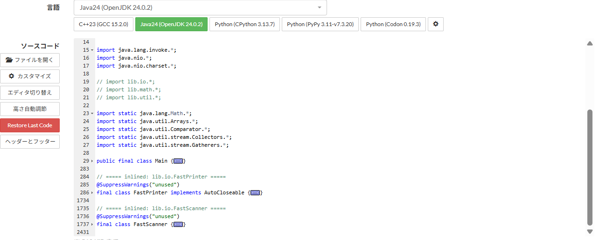
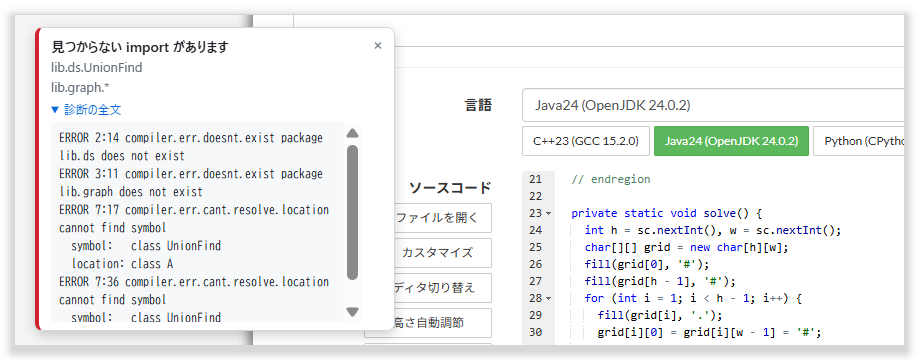

# Submission helper

[Back to the feature list](../../README.en.md#4-feature-list) ・ [日本語](submission-helper.md)

> Prepare pasted code for submission.

**This feature is off by default. Turn it on in settings.**

 Java code converted with Local Runner, with folding after pasting turned on. The class is renamed to <code>Main</code>, the <code>lib</code> imports become comments, and the library classes in use are added at the end.

## How it works

- Pasting a complete solution transforms it into a form that can be submitted. Pasting part of the code into the editor leaves the code unchanged.
- With [Local Runner integration](local-runner.en.md), the code is transformed with the Local Runner language that matches the language selected on the page. Local Runner's settings decide what is done: expanding libraries and renaming the class to `Main` for Java, and running the conversion command you set (`bundle`) and rewriting a debug variable for other languages.
- On AtCoder and yukicoder the helper uses the language selected on the site, and on Codeforces the language selector of the submission form. On AOJ, paiza and Library Checker it does not read the selector and uses the language the editor reports. If the editor cannot tell the language, such as a shared C/C++ mode, the code is not transformed.
- Without Local Runner, only a basic transform for each language is applied: the transform in the Java section for Java, and rewriting the debug variable for Python, C, C++, Go and Rust.
- A debug variable is set to `false` only when you set its name in the detailed settings. For languages other than Java, it is rewritten only when exactly one declaration or assignment exists outside blocks. If there are two or more, the original code is kept and a notification tells you so. With Local Runner, its `debugFlag` setting decides what is rewritten.
- When turned on in the detailed settings, the outermost blocks and comments are folded after the transformed code is applied to the editor. Nested blocks are not folded. It is off by default. The keys for folding and for submitting are in [Keyboard shortcuts](keyboard-shortcuts.en.md).
- The submission header is added by [Code header and footer](source-comments.en.md).
- If you submit while the code is being transformed or the header is being fetched, the submission waits until they finish. It is not submitted if the task, language or code changes while waiting, or if the transform fails. A failed transform shows the imports that could not be found or the first error.

 Imports that could not be found are listed in a notification. Open “Full diagnostics” for details.

## Java

For library setup, supported imports, and **the limits on `import static` during bundling**, see [Java libraries in Local Runner (Japanese)](../../../../local-runner/README.md#ライブラリを使う).

- Without Local Runner, the package declaration is removed and the top-level type that has `main` is renamed to `Main`. This only replaces text and is not guaranteed to be correct. Because text alone cannot tell a type from a variable, variables with the same name are renamed too. Comments and strings are left unchanged. If the type with `main` cannot be determined, another `Main` already exists, or a variable with the same name is also used as a member of another value (such as `new A().A`), the original code is kept and a notification tells you so. Use Local Runner for a reliable transform.
- Only a `boolean name = true` declaration directly in the class that runs is set to `false` as the debug variable.
- Use ordinary whitespace and line breaks in Java source. If the same file declares a type or type parameter named `String`, write the `main` parameter as `java.lang.String[]` or `java.lang.String...` so the fallback can identify the entry class.
- If you set the library package (e.g. `lib`) in the detailed settings, pasting code that imports it while Local Runner is unreachable shows a notification with a link to the setup steps. Submitting that code as it is causes a compile error.

## Detailed settings

Open this feature’s “Detailed settings” in CP Toolkit.

| Setting                                               | Default |
|-------------------------------------------------------|---------|
| Debug variable to set to false without Local Runner   | (empty) |
| Package of the Java library that Local Runner expands | (empty) |
| Fold the outermost blocks and comments after pasting  | Off     |

## Pages

- Task pages
- Submit page
- Custom test page
- yukicoder problem pages
- Codeforces
- AOJ
- Library Checker
- paiza
