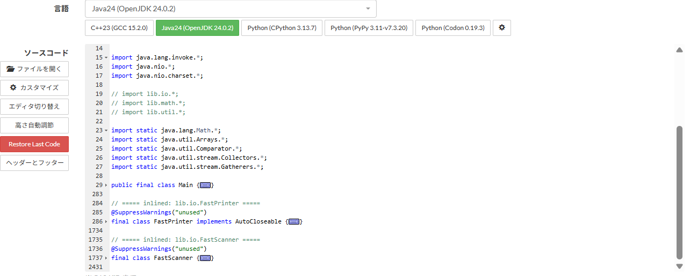
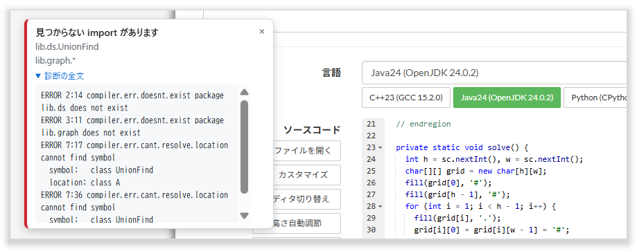

# 提出補助

[機能一覧へ戻る](../../README.md#4-機能一覧) ・ [English](submission-helper.en.md)

> 貼り付けたコードを提出用に変換します。

**この機能は既定で OFF です。設定画面で有効にしてください。**

 Local Runner で変換した Java のコード。クラス名は <code>Main</code> になり、<code>lib</code> の import はコメントに変わり、使ったライブラリのクラスが末尾に入って折りたたまれます。

## 使い方

- コード全体を貼り付けると、提出できる形に変換します。編集中のコードへ一部を貼り付けたときは変換しません。
- [Local Runner との連携](local-runner.md)があれば、ページで選んだ言語に合う Local Runner の言語で変換します。変換の内容は Local Runner の設定で決まります。Java ならライブラリの展開と `Main` への改名、ほかの言語なら `bundle` とデバッグ用の変数の書き換えです。
- 言語は、AtCoder と yukicoder ではサイトで選んだ言語、Codeforces では提出欄の言語の選択欄から決めます。AOJ、paiza、Library Checker では言語の選択欄を読まず、エディタが判定した言語を使います。C と C++ の共通の表示のように、エディタから言語を決められないときは変換しません。
- Local Runner がないときは、言語ごとの簡易の変換だけを行います。今は Java だけが対象です。
- 提出用のヘッダーは[コードのヘッダーとフッター](source-comments.md)が付けます。
- 変換とヘッダーの取得中に提出を押すと、完了まで待ちます。待機中に問題・言語・本文が変わった場合や変換に失敗した場合は、提出を取り消します。見つからない import の名前や最初のエラーを通知し、「診断の全文」から詳細を確認できます。

 見つからない import があると、名前を通知します。「診断の全文」で詳細を開けます。

## Java

- Local Runner がないときは、パッケージ宣言を削除し、`main` を持つトップレベルの型の名前を `Main` に変えます。字句の置き換えなので、確実ではありません。型か変数かを見分けられないので、同じ名前の変数もそろえて変えます。コメントと文字列の中は変えません。`main` を持つ型が決まらないとき、`Main` という名前がすでにあるとき、同じ名前の変数をほかの値のメンバーとしても使っているとき（`new A().A` など）は、元のコードを残して知らせます。確実に変換するには Local Runner を使ってください。
- デバッグ用の変数は、詳細設定に名前を入れたときだけ、起動するクラスの直下にある `boolean 名前 = true` の宣言を `false` にします。Local Runner での書き換えは、Local Runner の設定の `debugFlag` で決めます。
- 詳細設定にライブラリのパッケージ（例：`lib`）を入れておくと、Local Runner に接続できないときにそのパッケージを import したコードを貼り付けたとき、導入方法へのリンクを通知します。このまま提出するとコンパイルエラーになります。
- 変換したコードをエディタに反映すると、クラスとコメントを折りたたみます。キー操作で折りたたむ設定と、提出のキーは[ショートカットキー](keyboard-shortcuts.md)にあります。

## 詳細設定

設定画面でこの機能の「詳細設定」を開きます。

| 項目                                                     | 既定値   |
|----------------------------------------------------------|----------|
| Local Runner がないときに false にする Java の変数の名前  | （空欄） |
| Local Runner で展開する Java のライブラリのパッケージ    | （空欄） |
| 貼り付け後に Java のクラスとコメントを折りたたむ         | ON       |

## 動くページ

- 問題ページ
- 提出ページ
- コードテストのページ
- yukicoder の問題ページ
- Codeforces
- AOJ
- Library Checker
- paiza
