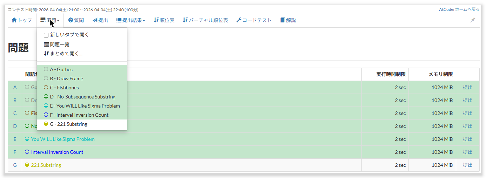

# Task status colors

[Back to the feature list](../../README.en.md#4-feature-list) ・ [日本語](task-status.md)

> Color tasks in the task list and the Tasks dropdown according to your submission results.

 Task list colored by your results: green for AC, red for submitted tasks without AC.

## How it works

- Colors in the task list and Tasks dropdown reflect your submissions, including those made after the contest.
- By default, green means at least one AC or a positive score. Red means all judged submissions scored zero and none was accepted. Unattempted tasks stay uncolored. Pending submissions are excluded.
- Results are fetched while you are signed in, starting five minutes after the contest begins.

 The Tasks dropdown uses the same colors.

## Detailed settings

Open this feature’s “Detailed settings” in CP Toolkit.

| Setting                                                | Default   |
|--------------------------------------------------------|-----------|
| Color for tasks with an AC or a positive score         | `#c3e6cb` |
| Color for attempted tasks with no AC or positive score | `#f5c6cb` |

## Pages

- Contest pages
