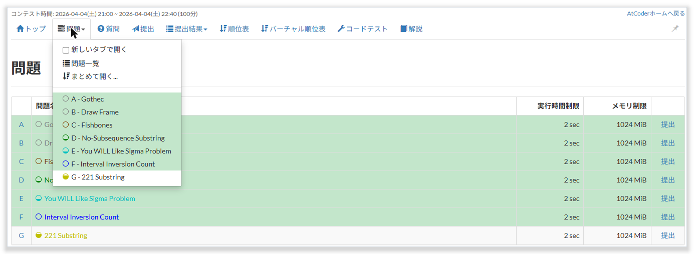

# 提出結果による問題の色分け

[機能一覧へ戻る](../../README.md#4-機能一覧) ・ [English](task-status.en.md)

> 自分の提出結果に応じて、問題一覧と「問題」タブのドロップダウンを色分けします。

 問題一覧の色分け。AC の問題は緑、提出したが AC でない問題は赤になります。

## 使い方

- 問題一覧と「問題」タブのドロップダウンには、コンテスト終了後も含めて自分の提出結果が反映されます。
- 既定では、AC または正の得点がある問題は緑、判定済みの提出がすべて非 AC・0点の問題は赤です。未提出の問題には色を付けず、判定中の提出は集計から除きます。
- ログイン中に結果を取得します。コンテスト開始から5分間は取得を控えます。

 「問題」タブのドロップダウンも、同じ色で色分けします。

## 詳細設定

設定画面でこの機能の「詳細設定」を開きます。

| 項目                              | 既定値    |
|-----------------------------------|-----------|
| AC または得点のある問題の色       | `#c3e6cb` |
| AC も得点もない提出済みの問題の色 | `#f5c6cb` |

## 動くページ

- コンテストのページ
